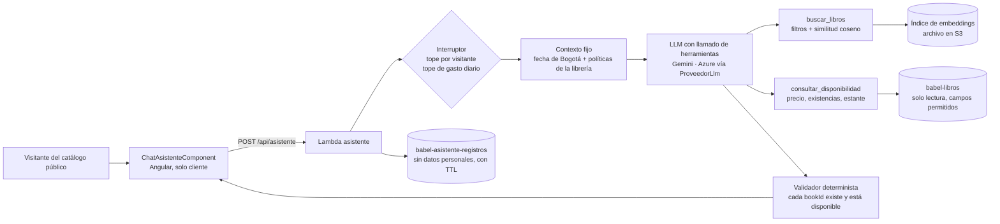

# Asistente de Babel — recomendador de libros con IA

> **Estado:** planeado (16/11/2026). Ninguna fase de implementación ha empezado. Este README se actualiza al cerrar cada fase; el avance real vive en [`PLAN.md`](PLAN.md) y en la [bitácora](bitacora/README.md).

Asistente conversacional para el catálogo público de **Babel**, la aplicación de inventario de la librería del centro cultural **Le Tiende** (Bogotá). Un visitante escribe lo que busca en lenguaje natural:

> "¿Qué libro le regalo a mi hijo adolescente, al que le gustan el manga y las historias tipo Harry Potter?"

y el asistente responde con 3 a 5 libros **que de verdad están en el estante**, explica cada recomendación a partir de su sinopsis, da el precio y la ubicación física, y dice "no tengo nada así" cuando no hay nada adecuado.

Más que la función en sí, el objetivo de este subproyecto es **demostrar con evidencia medible** el ciclo completo de ingeniería de prompts y agentes: fuentes de conocimiento, recuperación, llamado de herramientas, evaluación y regresión, versionado de prompts, métricas de operación, seguridad, privacidad y cambio de proveedor de modelo.

---

## Qué demuestra cada parte

| Capacidad | Dónde se construye | Evidencia |
|---|---|---|
| Fuentes de conocimiento: estructura, carga y consulta | Fase 1 — enriquecimiento del inventario con sinopsis, categorías, idioma y páginas | Proceso de carga, reporte de cobertura por idioma y fuente |
| Recuperación (RAG híbrido) | Fase 2 — índice de embeddings + filtros estructurados | Índice, recall@k medido sobre la suite |
| Asistente con límites de respuesta | Fases 2 y 7 — solo propone libros del inventario y sabe decir "no tengo nada así" | Demo en el catálogo público, código |
| Llamado de herramientas | Fase 3 — existencias, precio, estante y políticas, en vivo y de solo lectura | Código de las herramientas y casos de prueba |
| Pruebas funcionales y de regresión de agentes | Fase 4 — suite de 40 a 60 casos con compuerta que bloquea si algo empeora | `evals/`, tabla de resultados por versión |
| Versionar y optimizar prompts | Fase 5 — prompts en git con versión, motivo y corrida que lo justifica | `prompts/` con historial y fichas |
| Uso responsable, privacidad y seguridad | Fase 6 — topes, registro sin datos personales, inyección directa e indirecta | [Ficha de riesgos y controles](fichas/riesgos-y-controles.md), casos de seguridad |
| Métricas de desempeño y consumo | Fase 8 — tablero de aciertos, libros inventados, costo y latencia | Tablero en `/admin/asistente` y análisis de una página |
| Cambio de modelo y Azure | Fase 9 — misma suite contra otro modelo de Gemini y uno alojado en Azure | Tabla comparativa y procedimiento de cambio |
| Comunicar el caso de uso y capacitar | Fases 0 y 10 | [Ficha de caso de uso](fichas/caso-de-uso.md) (escrita antes de construir) y guía para la librería |

---

## Arquitectura (prevista)



Decisiones clave (detalle en los ADR-013 a ADR-017 de [`../docs/MEMORY.md`](../docs/MEMORY.md) §3):

- **Sin base vectorial administrada.** Unos 3.000 libros caben en un archivo de pocos MB que la Lambda compara en memoria. Costo cercano a cero (ADR-013).
- **El modelo nunca es la fuente de verdad del inventario.** Las herramientas devuelven solo campos públicos, y un validador descarta cualquier libro que no exista o esté agotado antes de responder. La tarjeta que ve el visitante se pinta con datos de Babel, no con texto del modelo (ADR-014).
- **Proveedor de modelo intercambiable** detrás de una interfaz `ProveedorLlm` (ADR-015).
- **Evaluación antes de cada cambio** de prompt o de modelo, contra una copia congelada del inventario (ADR-017).

---

## Estructura de esta carpeta

```
asistente-ia/
  README.md                  este archivo
  PLAN.md                    fases, criterios de terminado y estado
  fichas/
    caso-de-uso.md           problema, usuarios, datos, indicadores, riesgos, escalamiento (antes de construir)
    riesgos-y-controles.md   OWASP Top 10 para LLM aplicado a este asistente
  bitacora/
    README.md                índice, glosario y mapa capacidad → evidencia
    00-planeacion.md ...     una entrada por fase: tecnologías, decisiones, cifras, qué falló
    estudio.md               ruta de estudio (evaluación, Azure/AI-900, NIST AI RMF, Ley 1581)
  metrics/
    events/                  registro de esfuerzo (JSONL, ai-effort-tracking)
    reports/                 reportes de esfuerzo y costo por hito
  prompts/                   (Fase 2) prompts versionados + CHANGELOG + fichas
  evals/                     (Fase 4) casos, ejecutor, resultados agregados
  conocimiento/              (Fase 3) políticas de la librería que el asistente cita
```

El código de producción vive donde manda la convención de Babel (`server/api/...`, `src/app/features/...`). Este README enlazará cada pieza a medida que exista.

---

## Registro de esfuerzo

Cada sesión de trabajo se registra con la skill `ai-effort-tracking`: tiempo humano vs. tiempo de agente, peaje de revisión, tokens y costo, medidos desde el transcript y los hooks (nunca declarados de memoria). Los eventos de este subproyecto están en [`metrics/events/`](metrics/events/) (`project_id: babel-asistente-ia`) y los reportes por hito en [`metrics/reports/`](metrics/reports/). El instrumento compartido (configuración, precios, estado de hooks) está en `../metrics/` porque los hooks lo buscan en la raíz del repositorio.

Babel lleva además su registro general en `../tracking-detail.csv` (CLAUDE.md §8); cada tarea de este subproyecto aparece en ambos.

---

## Qué no se publica

El repositorio es público. **No** se suben las sinopsis (texto de editoriales obtenido vía Google Books y sitios de librerías), las copias congeladas del inventario, los resultados crudos de las evaluaciones ni ningún dato de ventas, costos o clientes de Le Tiende. A git solo van el código, los casos de prueba y las tablas agregadas. Ver `.gitignore`.
